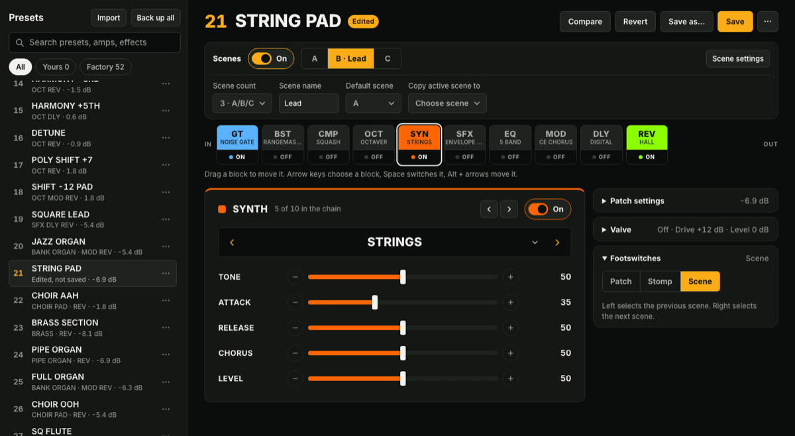
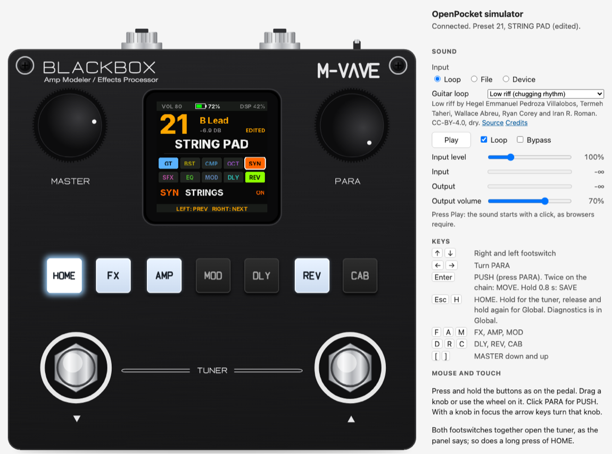

# OpenPocket Synth2

OpenPocket Synth2 turns the **Donner Pocket X** and **M-VAVE BlackBox** into guitar synth, pitch and boost pedals.
It is a fork of [OpenPocket by isod89](https://github.com/isod89/openpocket). The fork adds waveform-following
synths, chord-friendly pitch shifting, a dedicated preamp and boost block, and patch scenes you can switch from
the footswitches or web editor. Plug in a regular guitar and play without a special pickup.

[Web installer](https://daverage.github.io/openpocket/) · [Preset editor](https://daverage.github.io/openpocket/editor.html) · [Pedal controls](docs/SOUNDS-AND-CONTROLS.md) · [v97 release notes](docs/WHATS-NEW-v97.md)

*The v97 editor connected to a simulated pedal, with scene settings open.*

## What Synth2 adds

- **Guitar synths that follow your playing.** Bank Organ, Pipe Organ, Strings, Choir Pad and Brass build their sound
  from the guitar signal and follow picks, bends, slides and mutes. Strings Octave and Choir Octave add an **Octave Mix**
  control. SQ Brass, SQ Bass and SQ Flute give you three square-wave voices. Poly Oct Fuzz feeds chord-friendly
  octaves into a Fuzz Face model.
- **Pitch effects for chords and bass reinforcement.** Poly Octave HQ adds voices one octave up and one or two
  down. Lowest Octave HQ reinforces the lowest note in a chord. Poly Shifter transposes the whole signal
  by up to an octave either way, with fine tuning, mix and attack controls. At exact octaves it uses the
  Poly Octave HQ voices. Octaver, Whammy, Harmonizer and Detune round out the pitch block.
- **Dedicated PRE / BOOST and Valve stages.** PRE / BOOST includes Rangemaster, EP Boost, Maximizer, Fixed Wah,
  Enhance, Fuzz Face, Acoustic Pre and Signature. Use the separate 12AX7 Valve input stage alongside compression,
  with independent Drive and Level. The Noise Suppressor combines a gate, mains hum reduction and high-frequency
  hiss reduction.
- **Ten reorderable blocks and 52 factory patches.** The default chain is
  GATE → PRE / BOOST → COMP → OCTAVE → SYNTH → SPECIAL FX → EQ → MOD → DELAY → REVERB.
  The factory bank covers pitch and synth sounds, boosts, acoustic patches and conventional effects.
  The fork replaces DRIVE, AMP and CAB, including NAM amp models and user cabinet IRs, with a chain built around
  the synth, pitch and preamp effects.

See the [effects catalogue](docs/SOUNDS-AND-CONTROLS.md), [Poly Shifter guide](docs/POLY-SHIFTER.md)
and [pedal models](docs/PEDALS.md).

## Play and edit with scenes

Save **two or three scenes per patch** to switch between setups such as rhythm, lead and ambient. Each scene
recalls block on/off states, effect settings, Valve and patch volume. Scenes share the same models and routing.
With **Tails** enabled, delay and reverb can keep ringing when you bypass them or switch away from them.

On the pedal, tap **AMP** for Synth or **CAB** for Octave. From PLAY, open scene settings with **HOME → FX → PUSH**.
Hold **CAB** to cycle Patch, Stomp and Scene footswitch modes when scenes are enabled. Patch changes presets,
Stomp toggles assigned effects, and Scene recalls the previous or next scene in the current patch.

In the USB web editor, **Sound** edits the chain, recalls scenes, assigns footswitch actions and compares the
current sound with the saved patch. The preset list can back up and restore patches as JSON. Use **MIDI**
to learn controls from a connected controller and **Stage** for a larger live view with the tuner. The pedal
also supports USB MIDI and stereo 16-bit, 44.1 kHz USB audio.

[Scene and pedal controls](docs/SOUNDS-AND-CONTROLS.md) · [MIDI](docs/MIDI.md) · [USB audio](docs/USB-AUDIO.md)

## Try it without a pedal

Run `make sim` and open the local address it prints, usually `http://127.0.0.1:8766/`. The simulator runs the
pedal UI and audio engine, with a clickable pedal, the web editor and audio from a bundled guitar loop, a file or
your computer’s input. [Simulator guide](docs/SIMULATOR.md)

## Install

1. Back up your presets and keep a copy of the official firmware for your pedal.
2. Open the [web installer](https://daverage.github.io/openpocket/) in desktop Chrome or Edge. Connect the
   powered pedal with a USB data cable, click **Connect**, and allow MIDI access.
3. Confirm your model and **v97 · build 997** under **Available firmware**, then click **Install**. Leave the pedal
   powered and connected until the installer verifies it after restart.

The published packages are `PocketX_997.fwsc` and `BlackBox_997.fwsc`. The current source also includes follow-up
fixes for the stability of three legacy synth effects and the loudness of 12 factory patches. Those fixes
are available in local builds. Factory level adjustments apply when loading the factory patch for a slot.

When migrating from the original multi-effects preset format, Synth2 retains global settings and starts
with its factory bank. Retired synth types and Drop Tune load bypassed. Firmware older than v75 cannot read
the current preset-store format.

[Installation and local builds](docs/BUILDING.md#installing-from-the-browser) · [Restore stock firmware or recover a pedal](docs/RESCUE.md)

## Build

Use Docker and Node 18+ on macOS, Linux or Windows. Run `make doctor` to check prerequisites and `make package`
to build both firmware packages. Use `make serve` to open the locally built installer.
See the [build guide](docs/BUILDING.md) for the JieLi toolchain, native builds and optional test channels.

## Test (no pedal needed)

Run `make test` without a pedal to check DSP stability and preset loudness, preset storage under simulated
power loss, MIDI, USB audio, the installer and the editor. Browser tests cover the installer, editor, pedal
controls and simulator audio when Playwright is installed. To also verify rebuilding the official Pocket X
016 app area byte for byte, pass the original package to `tests/run_tests.sh PocketX_016.fwsc`.

## Layout

| Path | Contents |
| --- | --- |
| `engine/` | Portable C audio engine |
| `firmware/` | Pedal UI, preset store, audio, USB and board support |
| `loader/` | RAM-resident firmware update loader |
| `docs/` | Installer, editor, user guides and release notes |
| `tools/` and `tools/sim/` | Build, packaging and recovery tools, simulator and WebAssembly audio engine |
| `tests/` | Host DSP checks, pedal fixtures and browser tests |
| `flash/` | SD-card recovery with fm1buddy |

## Licence

GPL-3.0-only. Board support and loader are MPL-2.0 (felucca-bsp), JieLi SDK files are Apache-2.0, and Inter is
OFL 1.1. See [NOTICE.md](NOTICE.md) for Felucca and other third-party components. OpenPocket is independent of
Donner and M-VAVE.
